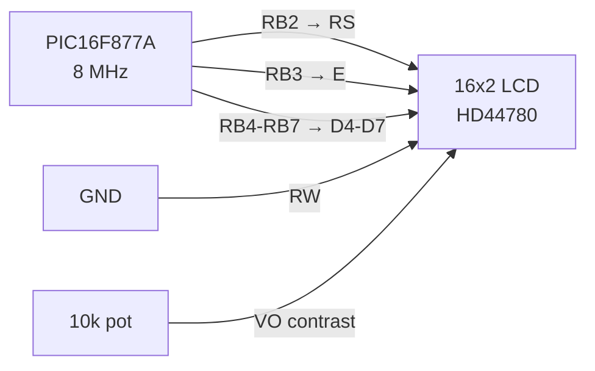
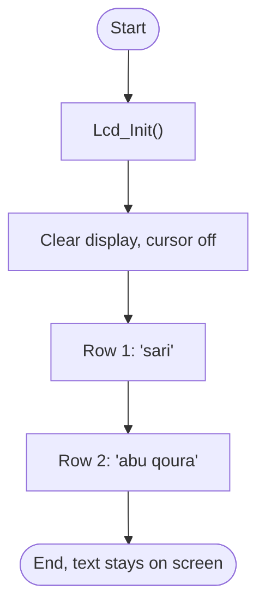

# Microcontroller-LCD-Screen

Displays two lines of text on a 16×2 character LCD (HD44780-compatible) driven in **4-bit mode** by a PIC16F877A, using the mikroC `Lcd` library.

## Target hardware & settings

| Setting | Value |
|---|---|
| Microcontroller | **PIC16F877A** |
| Clock | 8 MHz crystal (HS) |
| Compiler / IDE | mikroC PRO for PIC, `Lcd` library |
| Config word | `0x2F4A`: HS oscillator, WDT off, PWRT off, BOR on, LVP off, no code protection |

## Wiring

| LCD pin | PIC pin |
|---|---|
| RS | RB2 |
| E (EN) | RB3 |
| D4 | RB4 |
| D5 | RB5 |
| D6 | RB6 |
| D7 | RB7 |
| RW | GND (write only) |
| VO (contrast) | 10k potentiometer wiper |
| D0–D3 | not connected |

This same LCD wiring (RB2–RB7) is reused in the ADC, LDR, Potentiometer and GSM projects.

## How the code works (`lcd.c`)

1. **Pin mapping:** the `sbit LCD_RS at RB2_bit; …` and the `*_Direction` lines tell the mikroC `Lcd` library which pins and TRIS bits to use.
2. `Lcd_Init()` sets up the display in 4-bit mode.
3. `Lcd_Cmd(_LCD_CLEAR)` clears the display, and `Lcd_Cmd(_LCD_CURSOR_OFF)` hides the cursor.
4. `Lcd_Out(1,1,"sari")` writes to row 1, column 1, and `Lcd_Out(2,1,"abu qoura")` writes to row 2.
5. `main()` then returns. The text stays on the LCD because the controller keeps its contents.

The `txt1…txt4` arrays and the commented-out `ANSEL`/`C1ON` lines come from the mikroElektronika example and aren't used. Those registers don't exist on the 16F877A.

## Build & flash
Open `lcd.mcppi` in mikroC PRO for PIC (make sure the **Lcd** library is ticked in Library Manager), build, and flash `lcd.hex`.
